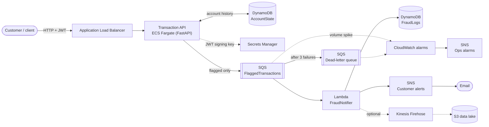

# Banking Fraud Detection & Customer Notification System

A cloud-native banking service on AWS that evaluates transactions for fraud in real time, flags suspicious ones and notifies the customer.

- **Transaction API** (Python / FastAPI) on **Amazon ECS Fargate** behind an **Application Load Balancer**
- **Amazon SQS** decouples fraud detection from notification
- **AWS Lambda** saves flagged transactions to **DynamoDB** and alerts customers via **Amazon SNS**
- All infrastructure is defined in code with **AWS CDK (Python)**

**Bonus challenges completed:** JWT authentication, multi-tenant fraud thresholds, CloudWatch alarms, Kinesis Data Firehose → S3 streaming (opt-in).

---

## Architecture



**Request flow**

1. The customer logs in (`POST /auth/login`) and receives a JWT. Failed attempts are recorded.
2. The customer submits a transaction (`POST /transactions`) through the ALB.
3. The API loads the account's recent history from DynamoDB and runs the fraud rules using the customer's bank's thresholds.
4. **Approved:** the response is returned immediately.
   **Flagged:** an event is published to SQS, then the response is returned. The API never waits on email delivery.
5. The Lambda consumes the event, writes it to the `FraudLogs` table, sends the customer alert through SNS and (optionally) streams it to S3 via Firehose.
6. Messages that fail three times move to a dead-letter queue, and a CloudWatch alarm fires.

**Why SQS between the API and the Lambda?** The customer-facing API stays fast and available even if email or DynamoDB writes are slow or failing. Alerts are buffered and retried, never lost.

---

## Fraud detection logic

All rules live in [`app/fraud_rules.py`](app/fraud_rules.py) as plain Python with no AWS code, so they are easy to read, test and change. A transaction is **flagged if any rule fires**. Each rule also has a weight, and the total is returned as a `risk_score` so analysts can prioritise their review queue.

| Rule | What it catches | Logic | Weight |
|---|---|---|---|
| `LARGE_AMOUNT` | Unusually large money movement | Withdrawal or transfer **above** the bank's limit. Deposits are excluded. | 40 |
| `GEO_VELOCITY` | "Impossible travel": card or credentials used in two places | Location differs from the account's previous transaction **and** the two are within the bank's time window | 35 |
| `FAILED_LOGINS` | Possible account takeover (password guessing, then a transaction) | Failed logins in the last 30 minutes ≥ the bank's limit | 50 |

**Multi-tenant thresholds.** Each bank (tenant) has its own settings in [`app/tenants.py`](app/tenants.py). The bank is identified by the account ID prefix (`MAPLE-1001`, `LAKESHORE-2001`).

| Setting | Maple Bank | Lakeshore Credit Union |
|---|---|---|
| Large amount limit | $5,000 | $2,000 |
| Geo-velocity window | 60 min | 120 min |
| Failed logins that trigger a flag | 3 | 2 |

**Design notes**
- Locations are compared after normalising case, spacing and commas, so `Toronto, ON` and `toronto,ON` are treated as the same place.
- Account history (last location and time, recent failed logins) is stored in DynamoDB rather than in memory, so every ECS task sees the same history and the service can scale out.
- Timestamps without a timezone are treated as UTC. If no timestamp is sent, the server's time is used.

---

## Repository structure

```
app/                  Transaction API (deployed to ECS Fargate)
  main.py               endpoints and request flow
  fraud_rules.py        the fraud rules (pure business logic)
  tenants.py            per-bank thresholds
  auth.py               JWT creation and validation
  storage.py            account history: DynamoDB or in-memory
  publisher.py          flagged events: SQS or log
  models.py             request and response schemas
  Dockerfile
lambda/notifier/
  handler.py          SQS-triggered Lambda: DynamoDB + SNS + Firehose
infra/                AWS CDK app (Python)
  fraud_stack.py        every AWS resource
scripts/demo.py       scripted end-to-end demo
tests/                pytest suite (rules, API, Lambda)
.github/workflows/    CI: runs the tests on every push
```

---

## Deploying

### Prerequisites
- AWS account and an IAM user with access keys (`aws configure`, region `us-east-2`)
- Python 3.12, Node.js (for the CDK CLI), Docker Desktop **running**, Git
- CDK CLI: `npm install -g aws-cdk`

### Steps (Windows PowerShell; on macOS/Linux use `source .venv/bin/activate`)

```powershell
cd infra
python -m venv .venv
.venv\Scripts\activate
pip install -r requirements.txt

# One time per AWS account/region: creates the bucket and ECR repo CDK uses
cdk bootstrap

# Deploy (about 5-10 minutes). The email receives fraud alerts and alarms.
cdk deploy -c alert_email=you@example.com
```

When it finishes, CDK prints the outputs, including:

```
BankingFraudDetectionStack.ApiUrl     = http://Banki-Trans-xxxx.us-east-2.elb.amazonaws.com
BankingFraudDetectionStack.ApiDocsUrl = http://Banki-Trans-xxxx.us-east-2.elb.amazonaws.com/docs
```

**Confirm the SNS email subscriptions.** AWS sends two "Subscription Confirmation" emails (customer alerts and ops alarms). Click the link in each one, or no alerts will arrive.

**Optional: Firehose → S3 data lake**
```powershell
cdk deploy -c alert_email=you@example.com -c enable_firehose=true
```

### Tear down (stops all charges)
```powershell
cdk destroy
```

### Estimated cost
The ALB and one small Fargate task run around the clock while deployed, which adds up to roughly a few dollars per week. DynamoDB, SQS, Lambda and SNS are pay-per-use and effectively free at demo volumes. There is no NAT gateway. Destroy the stack when you're not using it; redeploying takes one command.

---

## Running locally (no AWS needed)

Without `STATE_TABLE_NAME` and `FRAUD_QUEUE_URL` set, the API uses an in-memory store and logs flagged events instead of sending them to SQS.

```powershell
pip install -r requirements-dev.txt
cd app
uvicorn main:app --reload
# open http://localhost:8000/docs
```

Run the tests from the repository root:

```powershell
pytest -v
```

---

## API usage

Base URL: the `ApiUrl` output, or `http://localhost:8000` locally. Interactive Swagger docs are at **`/docs`**.

Demo customers: any account ID like `MAPLE-1001` or `LAKESHORE-2001` (bank code, a dash, then 4–10 digits). Password: `Demo@1234`.

### `POST /auth/login`
```json
// request
{ "account_id": "MAPLE-1001", "password": "Demo@1234" }

// 200 response
{ "access_token": "eyJhbGciOi...", "token_type": "bearer", "expires_in": 3600,
  "account_id": "MAPLE-1001", "bank": "Maple Bank" }
```
A wrong password returns `401` and is recorded for the `FAILED_LOGINS` rule.

### `POST /transactions`
Header: `Authorization: Bearer <access_token>`

| Field | Type | Required | Notes |
|---|---|---|---|
| `account_id` | string | yes | must match the logged-in account |
| `amount` | number | yes | greater than 0 |
| `transaction_type` | string | yes | `withdrawal`, `deposit` or `transfer` |
| `location` | string | yes | e.g. `"Toronto, ON"` |
| `timestamp` | ISO 8601 string | no | defaults to now |

```json
// request
{ "account_id": "MAPLE-1001", "amount": 7500, "transaction_type": "withdrawal",
  "location": "Toronto, ON", "timestamp": "2026-10-24T14:30:00Z" }

// 200 response
{
  "transaction_id": "txn_3f9c2a1b7d4e5f60",
  "account_id": "MAPLE-1001",
  "bank": "Maple Bank",
  "status": "flagged",
  "risk_score": 40,
  "rules_triggered": ["LARGE_AMOUNT"],
  "reasons": ["Withdrawal of $7,500.00 is above Maple Bank's limit of $5,000.00"],
  "evaluated_at": "2026-10-24T14:30:01.123456Z"
}
```

| Status code | Meaning |
|---|---|
| `200` | Evaluated: `status` is `approved` or `flagged` |
| `401` | Missing, invalid or expired token |
| `403` | Token belongs to a different account |
| `404` | Unknown bank or account format |
| `422` | Invalid request body (e.g. negative amount, unknown transaction type) |
| `503` | Flagged, but the alert could not be queued. Safe to retry. |

### `GET /accounts/me/thresholds`
Returns the fraud thresholds of the logged-in customer's bank.

### `GET /health`
Load balancer health check: `{"status": "ok"}`.

### Scripted demo
```powershell
python scripts/demo.py --url <ApiUrl>
```
Walks through approved activity, each fraud rule, the multi-tenant difference and the security checks.

### Example with curl
```bash
TOKEN=$(curl -s -X POST $API/auth/login -H "Content-Type: application/json" \
  -d '{"account_id":"MAPLE-1001","password":"Demo@1234"}' | jq -r .access_token)

curl -X POST $API/transactions -H "Authorization: Bearer $TOKEN" -H "Content-Type: application/json" \
  -d '{"account_id":"MAPLE-1001","amount":7500,"transaction_type":"withdrawal","location":"Toronto, ON"}'
```

---

## Security

- **IAM least privilege:** the API task role can only send to the one SQS queue and read and write the AccountState table. The Lambda can only write to FraudLogs, publish to its SNS topic and (if enabled) put records to its Firehose stream. All policies are generated by CDK `grant_*` calls.
- **Network:** ECS tasks accept traffic only from the ALB's security group. All data stores are AWS-managed services reached over TLS. The SQS queues reject non-TLS requests.
- **Secrets:** the JWT signing key is generated in Secrets Manager and injected at runtime, never stored in code.
- **Encryption at rest:** DynamoDB tables, SQS queues and the S3 bucket are encrypted. The bucket blocks all public access.
- **Containers** run as a non-root user.
- **Auth:** tokens expire after 60 minutes. Customers can only transact on their own account. Login errors don't reveal whether an account exists.

**Known demo shortcuts** (would change in production):
- The ALB listens on **HTTP**. Production would add an ACM certificate and a custom domain for HTTPS, plus AWS WAF for rate limiting.
- Demo customers share one password. Production would use a real identity provider such as Amazon Cognito.
- Thresholds are in code. Production would store them in a database or AWS AppConfig so each bank's risk team could tune them without a deployment.

## Future improvements
- Real distance-based impossible-travel check (km/h between geo-coordinates) instead of comparing location names
- Per-tenant CloudWatch metrics and alarms
- An analyst endpoint or dashboard to review and clear flagged transactions (`review_status`)
- Train an ML model on the S3 data lake (e.g. with SageMaker) to complement the rules
